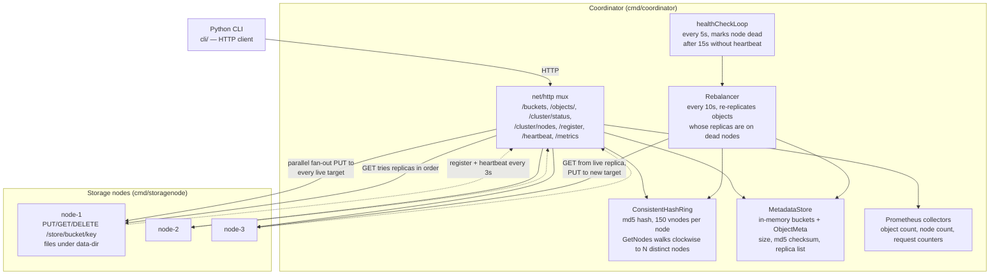
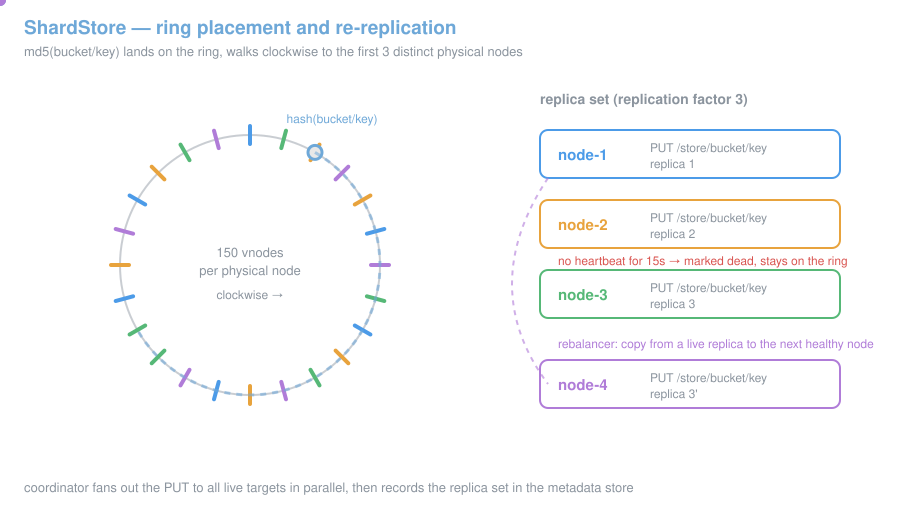

# ShardStore - Distributed Object Storage

A distributed object storage system with consistent hashing, replication factor 3, automatic rebalancing, and Prometheus metrics.

## Architecture



Objects are hashed to a consistent hash ring (150 virtual nodes per physical node, MD5-based). Each object is replicated to 3 distinct physical nodes. Dead nodes stay on the ring; the rebalancer simply asks for extra candidates and skips the ones that are not alive.



## Prerequisites

- Go 1.22+
- Python 3.11+
- Docker & Docker Compose (for containerized deployment)
- kubectl (for Kubernetes deployment)

## Building

```bash
# Build coordinator
go build -o bin/coordinator ./cmd/coordinator

# Build storage node
go build -o bin/storagenode ./cmd/storagenode
```

## Running Locally

Start the coordinator:

```bash
./bin/coordinator --port 8080
```

Start 3 storage nodes (in separate terminals):

```bash
./bin/storagenode --port 9001 --node-id node-1 --coordinator-url http://localhost:8080 --data-dir ./data/node1
./bin/storagenode --port 9002 --node-id node-2 --coordinator-url http://localhost:8080 --data-dir ./data/node2
./bin/storagenode --port 9003 --node-id node-3 --coordinator-url http://localhost:8080 --data-dir ./data/node3
```

## Python CLI

Install dependencies:

```bash
cd cli
pip install -r requirements.txt
```

Usage:

```bash
# Set coordinator URL (default: http://localhost:8080)
export SHARD_STORE_URL=http://localhost:8080

# Bucket operations
python cli.py bucket create my-bucket
python cli.py bucket list
python cli.py bucket delete my-bucket

# Object operations
python cli.py object put my-bucket my-key ./local-file.txt
python cli.py object get my-bucket my-key --output ./downloaded.txt
python cli.py object delete my-bucket my-key

# Cluster status
python cli.py cluster status
```

## Docker Compose Quickstart

```bash
cd deploy/docker
docker compose up -d

# Use the CLI
docker compose run --rm cli bucket create test-bucket
docker compose run --rm cli object put test-bucket hello ./some-file.txt
docker compose run --rm cli cluster status
```

## Kubernetes Deployment

```bash
kubectl apply -f deploy/k8s/configmap.yaml
kubectl apply -f deploy/k8s/coordinator-deployment.yaml
kubectl apply -f deploy/k8s/storagenode-statefulset.yaml
```

## API Reference

### Bucket Operations

| Method | Path | Description |
|--------|------|-------------|
| PUT | `/buckets/{name}` | Create bucket |
| DELETE | `/buckets/{name}` | Delete bucket |
| GET | `/buckets` | List buckets |

### Object Operations

| Method | Path | Description |
|--------|------|-------------|
| PUT | `/objects/{bucket}/{key}` | Upload object (body = raw bytes) |
| GET | `/objects/{bucket}/{key}` | Download object |
| DELETE | `/objects/{bucket}/{key}` | Delete object |

### Cluster Operations

| Method | Path | Description |
|--------|------|-------------|
| GET | `/cluster/status` | Node health, ring state |
| POST | `/cluster/nodes` | Register a new node |

### Metrics

Prometheus metrics are available at `/metrics` on both the coordinator (port 8080) and storage nodes.

Key metrics:
- `shardstore_objects_total` - total objects stored
- `shardstore_nodes_total` - healthy node count
- `shardstore_put_requests_total` - PUT request counter
- `shardstore_get_requests_total` - GET request counter
- `shardstore_under_replicated_objects` - under-replicated object count
- `storagenode_objects_total{node_id}` - objects per node
- `storagenode_disk_usage_bytes{node_id}` - disk usage per node

## Tests

Unit tests are not yet committed. End-to-end validation is performed by bringing up the cluster (Docker Compose) and exercising the Python CLI:

```bash
go vet ./...
go build ./...

# Bring up cluster
cd deploy/docker && docker compose up -d

# E2E: put then get an object
echo "hello shardstore" > /tmp/sample.txt
python cli/cli.py bucket create test-bucket
python cli/cli.py object put test-bucket hello /tmp/sample.txt
python cli/cli.py object get test-bucket hello --output /tmp/out.txt
diff /tmp/sample.txt /tmp/out.txt

# Failure injection: stop one node and verify rebalance restores 3 replicas
docker compose stop storagenode-2
python cli/cli.py cluster status   # under_replicated > 0 then drains to 0
```

## Monitoring

Import `monitoring/grafana/dashboard.json` into Grafana. Panels include object counts, node health, request rates, and per-node disk usage.
